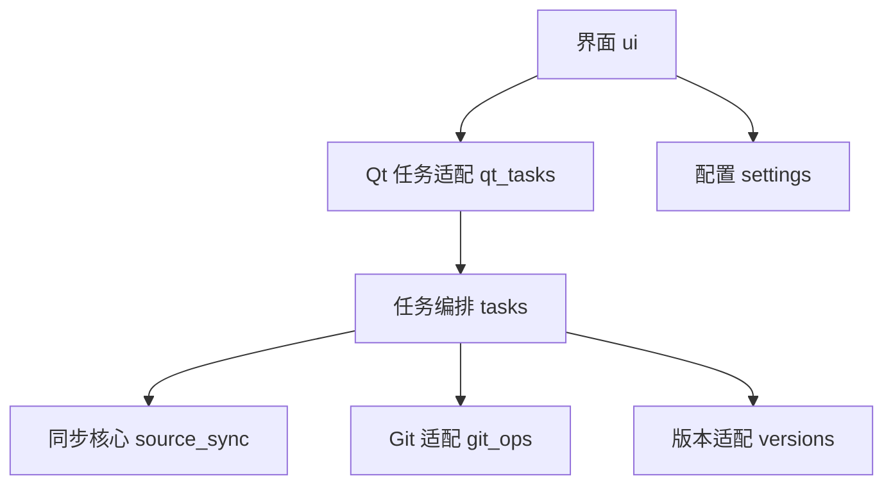

# 技术架构与开发规范

适用版本：0.1.6。本文是独立工具工程的公开维护基线，操作顺序、同步范围和编码契约见项目README；不依赖私人交接文档。

架构与项目开发约定共同作为实现基线。职责、依赖方向、数据契约及四个操作的语义必须遵守；示例类型和函数名可以随实际代码合理调整。调整公共契约或改变行为时，先更新相应规范和验收场景，再实现。

### 5.1 架构选择与层次

采用单进程桌面程序、一个活动后台任务、小规模模块分层。GUI 使用 Qt，业务核心使用普通 Python。首版无需数据库、后台服务、插件系统、事件总线、依赖注入容器或通用工作流引擎。

| 职责层 | 负责 | 边界 |
| --- | --- | --- |
| 界面与 Qt 适配 | 窗口、配置编辑、任务发起、日志呈现、线程生命周期 | 不写同步规则，不直接执行 Git |
| 任务编排 | 四个操作的阶段顺序、前置检查、结果与失败收口 | 不读取控件，不含 Qt 类型 |
| 同步核心 | 路径映射、范围选择、稳定读取、比较、变更计划与应用 | 不决定 pull/commit/push 时机，不弹窗 |
| 外部适配 | Git 子进程、仓库版本解析器、配置文件、Windows 共享读取 | 隐藏外部接口细节，返回明确数据或错误 |

依赖方向如下。箭头表示直接调用；公共数据模型为各模块共享的叶子依赖，未在图中重复绘制。

只允许 main.py 组装实际依赖；模块可以正常导入数据模型和普通辅助函数，不引入服务定位器或隐藏的全局可变上下文。source_sync.py 不导入 git_ops.py；需要的基线内容由编排层提供读取能力或快照。这样以后增加命令行入口，可以直接调用 tasks，而无需启动 Qt。

### 5.2 初始源码组织

实现项目使用 src/ws_git_sync/ Python 包；以下是包内模块职责，不要求每种数据结构都建独立文件。

| 文件/目录 | 唯一主要职责 |
| --- | --- |
| main.py | 启动、组装依赖、创建主窗口、统一退出 |
| models.py | dataclass、枚举、结构化结果与错误；无 Qt、无文件或网络 IO |
| settings.py | 配置验证、版本迁移、原子保存；返回普通数据 |
| versions.py | 加载当前仓库解析器，校验固定 ID、路径角色及目标边界 |
| source_sync.py | 范围、过滤、稳定读取、比较、构建和应用计划；内部将读取/比较/写入分成清晰函数 |
| git_ops.py | Git 探测、命令执行、状态与 Blob 读取、拉取/暂存/提交/上传 |
| tasks.py | preview/sync/pull/push 四个用例、任务状态与结果 |
| qt_tasks.py | QObject worker、QThread 生命周期、把核心事件转成 Qt 信号 |
| ui.py | 主窗口、配置编辑状态、列表、日志、布局与对话框 |
| window_frame.py | Qt窗口按钮绘制、边缘与角部缩放；不依赖任务或同步核心 |
| native_windows.py | Windows窗口样式、原生消息、应用标识与图标；非Windows不执行原生API |
| win_io.py | 必要的 Windows 只读共享句柄；只有普通读取不足时才单独实现 |
| tests/ | 项目根下的核心单元测试与临时 Git 集成测试 |
| packaging/ | 项目根下的 Windows 打包配置与构建说明 |

职责已清楚的函数先放现有模块；真实复杂度增加后再拆文件。不用固定行数强制拆分，也不把整个工具写成 UI 回调里的一个长函数。

项目位于工具集合仓库独立的ws-git-sync一级目录，自行管理源码、资源、依赖、测试与启动入口，不和其他工具共用配置或虚拟环境。

### 5.3 核心数据契约

跨模块以有类型的数据结构传递；路径使用 pathlib.Path，Git 对象和文件内容使用 bytes 或明确的对象 ID。禁止把日志文字、控件文本或未约束的字典当成业务协议。

| 数据 | 至少包含 | 生命周期与约束 |
| --- | --- | --- |
| Profile / AppSettings | README中的配置项 | 持久配置；UI编辑草稿和已保存配置分开 |
| TaskRequest | task_id、operation、配置快照、仓库/remote/branch | 任务创建后不可变，不携带 QWidget/QObject |
| ResolvedContext | 固定 ID、当前名称、两端源根、仓库目标根、解析依据 | 最新 Git 基线后产生；不跨任务复用旧路径 |
| FileSnapshot | 路径、读取状态、长度、时间、摘要、稳定内容引用 | 不存在、不可读、持续变化是不同状态 |
| ChangeItem | add/modify/delete、仓库相对路径、源引用、比较依据、目标原状态 | 一条路径最多一个最终操作；过滤/派生跳过另计 |
| ChangePlan | task_id、version_id、HEAD、规则指纹、目标根、变更项与统计 | 构建后只读；预览不会成为下一次执行的授权清单 |
| TaskEvent | task_id、序号、时间、阶段、级别、事件码、消息、可选路径 | 核心按序发出，UI 只负责呈现 |
| TaskResult | 结果状态、完成阶段、统计、commit_id、上传结果、错误、残留改动 | 上传结果独立于提交结果；失败也返回已完成事实 |

枚举用于操作、阶段、变更类型和结果；内部字段与 JSON 配置字段之间由 settings.py 显式转换，不把 dataclass 随意序列化后当长期存储格式。

任务入口的设计契约为 run_task(request, dependencies, emit) → TaskResult。dependencies 通过构造参数或明确参数传入 Git、版本解析与同步能力；emit 接收普通 TaskEvent。只有真正需要替换实现或隔离测试的边界才引入 Protocol，不为每个函数创建接口、基类和工厂。

### 5.4 计划、应用与一致性

同步必须区分“扫描得到什么”和“真正改了什么”：

1. 先验证源根可访问、仓库干净、版本身份及映射边界，再构建计划。
2. 按README同步范围和编码契约构建稳定快照；完整枚举和读取失败不能被解释成删除。无法确认范围完整时，本轮失败，不应用部分扫描结果。
3. 新增/修改项保留已稳定读取的原始内容。小文件可保留内存，大文件或总量较大时写入应用临时目录；临时内容不放入真实工程。删除项保存目标原状态与缺失依据。
4. 应用前重新核对 HEAD、暂存区、相关工作区状态、规则及源变化；不一致则停止并重新扫描，不执行过期清单。
5. 应用函数只允许写 Git 副本中计划声明的工程目标，不能接受任意目标根、不能修改源路径。写文件使用目标旁临时文件替换，避免单个文件留下半写入内容。
6. 单文件替换不等于整次同步事务。应用中途失败时记录已完成/未完成项，停止暂存和提交；保留可检查现场，不自动全仓reset或承诺无条件回滚。
7. 暂存使用明确的仓库相对路径和 Git 字面路径语义，覆盖新增、修改、删除；含空格、中文及路径特殊字符均须正确。验证暂存路径集合和预期内容，意外项导致停止提交。
8. 只有 Commit 成功后才记录 commit_id；Push 成功才记录 uploaded。不能由最后一行“完成”推断所有阶段成功。

Git可能按autocrlf或attributes处理文件，使计划中的字节修改不出现在暂存差异中。仅当该项为修改、工作区字节仍与稳定源相同、索引Blob等于源经Git处理后的Blob且等于原HEAD时，允许将其视为无实际提交差异；新增和删除不能通过此例外。计划外暂存始终失败，真正漏暂存报告具体路径。提交范围必须等于核验后的实际暂存范围；提交后仍核对包括无差异项在内的计划内容。无实际暂存差异不创建空提交，仍按正常流程上传已有提交。

预览与同步必须调用同一个计划构建入口。预览止于计划输出；同步在 pull 后重建计划，再应用。读取基线 Blob 的能力可由 Git 适配提供，但比较规则不写进 Git 命令层。

### 5.5 后台任务、状态与退出

GUI 主线程仅操作控件和短时配置操作。QObject worker 移入 QThread，后台执行 run_task；经信号把事件和最终结果发送回主线程。worker 不持有控件引用，GUI 不轮询线程共享字典。

首版全局只运行一个任务；对同一程序配置目录采用单实例约束，避免两个本工具进程同时写配置或仓库。外部 Git 客户端仍可能修改仓库，因此阶段前复核不可省略；不能宣称该约束锁住了所有 Git 程序。

| 状态类别 | 约束 |
| --- | --- |
| IDLE | 可以编辑配置、切换版本、开始任务 |
| 活动阶段 | VALIDATING、UPDATING、RESOLVING、SCANNING、APPLYING、STAGING、COMMITTING、PUSHING；各操作仅走所需阶段 |
| SUCCEEDED / NO_CHANGES | 记录实际完成事实；无文件变化不代表没有待上传提交 |
| FAILED | 有结构化错误，可能存在本任务已应用项或未上传提交 |

四个操作的具体阶段顺序以README为准，不要求给四个入口套同一个强制流水线。任务结束后保留结果再回到可操作态；任务锁只在 worker 真正结束并回收后解除。

首版不增加强制终止按钮。运行中点击关闭，提供继续等待或取消本次关闭；不调用 QThread.terminate，也不在写文件、commit、rebase 或 push 中杀进程。后续若增加取消功能，只能在明确安全阶段检查取消请求；须另定义中间状态和恢复测试。

文件读取按已有规则有限重试；网络或 Git 失败不进入无限自动重试。Git 认证沿用本机凭据；无法交互时返回明确错误，不能静默挂起。大批量日志可合并刷新，保留事件顺序，避免每个文件都触发一次昂贵的界面重绘。

### 5.6 外部接口与配置演进

- **Git：** git_ops.py 集中执行命令和解析输出，返回退出码、原始输出与结构化状态；上层按阶段解释。命令输出可能含凭据时脱敏后再进入日志。路径解析使用 NUL 分隔与字面路径，不能按空格拆文件名。
- **版本解析器：** 仅从已选择且用户信任的 ws 仓库明确路径加载；这是执行仓库 Python 代码的信任边界，不宣称沙箱。按仓库根与解析器内容身份区分加载，禁止复用另一仓库的同名模块；拉取后的加载不写 __pycache__ 到目标仓库。接口变化明确报错，不静默回退到复制来的过期解析器。
- **本机配置：** schema_version 与应用版本分开。升级逐版本迁移，替换前保留可恢复旧内容；遇到高于当前支持的 schema 拒绝覆盖，并提示兼容性问题。损坏配置不可自动重置成空文件。
- **存储：** 持久配置及实例锁位于程序同目录，不依赖启动工作目录；任务临时内容使用本工具创建的临时目录。个人配置必须排除在源码提交和发行包之外；源码仓库不存个人路径、凭据、测试生产数据和发行中间物。临时目录只清理本工具创建的内容；失败时若有保留，结果中标明其用途。
- **打包：** 动态仓库解析器、PySide6 插件和 Python 标准库依赖在发行版验证，不以开发环境能运行代替验收。每次发行记录应用版本、源码提交和锁定依赖组合。

### 5.7 扩展方式与架构变更

| 后续需求 | 首选修改位置 | 需要保持的契约 |
| --- | --- | --- |
| 增加一种目录/文件类型 | source_sync 中的范围和比较规则 | 不把同步范围藏进 UI，不改变旧规则结果 |
| 调整界面布局或增加命令行 | ui / 新入口 | 共用 TaskRequest、tasks 和 TaskResult |
| 批量处理多个配置 | tasks 外的显式批次编排 | 逐配置结果；同一 Git 仓库串行，不能直接并发四个用例 |
| 逐版本过滤配置 | settings + 扫描规则 | 明确继承语义、迁移和规则指纹，不直接套多层覆盖 |
| 替换 Git 或版本读取方式 | git_ops / versions | 上层任务语义和结构化结果保持稳定 |

这些是扩展位置说明，不是首版待实现功能。现在不预建批次系统、插件接口或远程 API。

改变同步方向、收录/删除范围、编码、分支策略、配置兼容性、公共数据契约、线程模型或依赖方向时，必须先在本文件相关章节记录原因、影响和验收，再修改代码。影响用户既有行为的改变需要用户裁决；模块内重构和错误修复按既定契约继续推进，不额外设置审批流程。

## 项目开发约定

本节是轻量项目约定，与上述架构共同约束开发。它适用于本桌面工具；不将游戏Lua、引擎UI或服务端部署文件的规范机械套到Python工程。无需另建治理系统。

### 16.1 编码与依赖

1. Python源码、项目说明和JSON使用UTF-8；这是工具自身编码，不能改变README中真实工程文件的编码契约。
2. 变量、函数和模块使用清楚的英文 snake_case；类使用 PascalCase。用户界面、主要注释和错误说明用中文，Git 原始诊断可作为补充。
3. 公共入口、跨模块数据和关键返回值写类型标注。数据模型优先 dataclass/Enum；任务输入和计划采用不可变结构，集合也避免共享可变引用。不追求给每个局部变量标类型。
4. 用直白函数和明确参数实现。优先组合，避免无实际复用的继承、万能 utils.py、大量一行转发层及把状态放进全局变量。
5. 注释解释编码比较、删除依据、路径边界、重试与 rebase 的原因和限制，不逐行复述代码。关键流程函数写简短契约说明，列清输入、写入范围和失败后状态。
6. 统一使用Ruff做格式与基础静态检查，pytest做行为测试；开发依赖与运行依赖区分，版本由锁文件固定。不增加强制全量类型检查或无意义覆盖率门槛。
7. pyproject.toml 保存项目元数据、工具设置和直接依赖；锁定文件记录实际构建使用的依赖。升级 Python、Qt 或打包依赖需重跑对应启动/DPI/发行包验证，不顺带升级无关依赖。

### 16.2 错误、日志与配置

8. 错误携带稳定 code、stage、用户消息、可选路径和底层 cause；由任务边界统一转成 TaskResult。禁止空 except、读取失败返回空内容、或用日志里的关键词驱动下一步操作。
9. 预期错误显示可操作原因；意外错误显示摘要并保留排障信息。日志不包含令牌、密码和敏感远端认证信息；本机绝对路径只用于本机排障，不自动外传。
10. 已保存配置、正在编辑的草稿、单次任务快照分开保存。保存后字段低强调，点击进入编辑；任务执行时使用冻结快照，不读取 UI 实时文本。
11. 首次运行使用已确认的布局参数，之后按有效本机配置恢复。布局参数越界时夹到可用范围；业务配置损坏则明确报告，不借布局恢复静默重置业务配置。

### 16.3 开发节奏与完成标准

12. 增量交付时更新实际完成状态、验证结果和未解决项。新功能先对照规范确定归属，再写代码；不把“以后可能用到”作为新增架构层的理由。
13. 修改规则、计划或 Git 行为时，增加能证明真实结果的临时仓库场景；纯文案、颜色和低影响布局调整不写镜像实现的单元测试，使用实际界面核验。
14. 自动检查使用项目环境中的 `ruff check .`、`ruff format --check .`、`pytest`。核心测试可不启动 Qt；Windows IO、Qt 和打包相关验证明确区分环境及未执行项。
15. 同步场景验证最终文件字节、Git 树、提交范围和源目录未变化；失败场景验证残留状态及可重试性。不能只验证日志出现“成功”或 mock 被调用。
16. 完成一个功能意味着：职责符合架构、既有操作语义不漂移、适用检查通过、错误结果可检查、界面与核心状态一致。发行还需development.md中的Windows与真实工程验收，不能由Linux自动测试替代。
17. 改变用户已确认的界面、同步范围、编码或 Git 策略时，先说明具体变化和影响，由用户裁决；既定范围内的实现选择、常规修复和重构直接推进。

### 16.4 开发时的简短自检

每个里程碑在实现仓库的开发记录中回答以下问题即可，不另外生成重复长报告：

- 这次行为是否仍符合README中的操作与范围，是否严格保持真实工程只读？
- 新逻辑是否放在正确模块，核心是否可以脱离 Qt 验证？
- 输入快照、计划、实际应用和 Git 提交范围是否一致？
- 失败后留下什么，日志与 TaskResult 是否如实表达？
- 哪些检查已执行、哪些仍需 Windows 或用户实机？

启动、开发检查和打包入口统一由项目README导航；本文件维护架构，development.md维护当前验证状态，避免重复维护操作语义。

### 窗口与列表

默认窗口仍为 1080×720，最小 900×600；四边、四角可拖动缩放并记住正常窗口尺寸；每次启动在主屏可用区域居中，不恢复上次坐标。最大化或全屏时隐藏缩放区。优先使用 Qt 系统缩放，不支持时按鼠标位移调整尺寸，遵守最小与最大尺寸限制。

窗口使用略暗的白色调，外框和区域分界可辨认；保留低强调编辑字段与四色按钮。列表名称与版本 ID 分行展示，名称随侧栏宽度换行，行高由内容决定，避免固定高度和双重内边距造成截断。

标题栏不提供布局设置入口。版本卡片单行名称时约48像素高，名称与ID间距1像素，长名称按内容增高。配置区默认175像素，旧布局首次加载迁移到175，保留业务配置和窗口尺寸，之后继续保存用户拖动后的高度。

窗口控制用QPainter绘制抗锯齿线条：常态无底框，悬停淡灰，关闭悬停红底白线；最大化切换重叠窗口还原图标。绘制与DPI缩放交给Qt。每次启动忽略历史x/y，仅恢复尺寸后居中。日志不重复显示变更类型文案，滚动条使用窄轨道。

### 初始化与Windows集成

新增INITIALIZE操作，由非Git目录首次操作失败后的用户确认触发；UI只收集地址并发起后台任务，不直接执行Git。任务层先校验所有已配置真实工程边界，再由Git适配器在独立临时目录克隆远端元数据、迁入目标.git。空目录通过不强制覆盖的checkout-index检出；非空目录不检出、不覆盖、删除、暂存或提交既有文件。失败保留已有文件，损坏元数据和嵌套仓库不重新初始化。成功后重试用户原操作，干净工作区门禁继续生效。新clone_url为兼容配置字段，不保存带密码/令牌的地址，不自动建立Git用户身份。

Windows适配器补全WS_OVERLAPPEDWINDOW与WS_EX_APPWINDOW，使用WM_NCCALCSIZE保留自绘外观，最大化客户区按所在显示器工作区计算。系统最小化与还原不自行实现动画，窗口/进程/发行图标使用相同ICO。

### 便携配置

冻结版以sys.executable的父目录为准，源码版以模块所属项目根为准，不依赖cwd或PyInstaller临时解包位置。settings.json与instance.lock位于同目录；配置缺失时仅首次复制有效旧用户配置且保留原件，已有同目录配置绝不由旧配置覆盖。目录不可写时失败，不回退用户目录。启动冒烟测试使用隔离临时目录，不能污染用户配置。不同目录的程序副本各自维护配置与实例锁，外部Git并发边界不变。

公开源码不预填个人仓库地址或业务过滤文件名；已有配置继续保留这些字段。新配置在同步前核对过滤清单，初始化时必须填写有效仓库地址。
